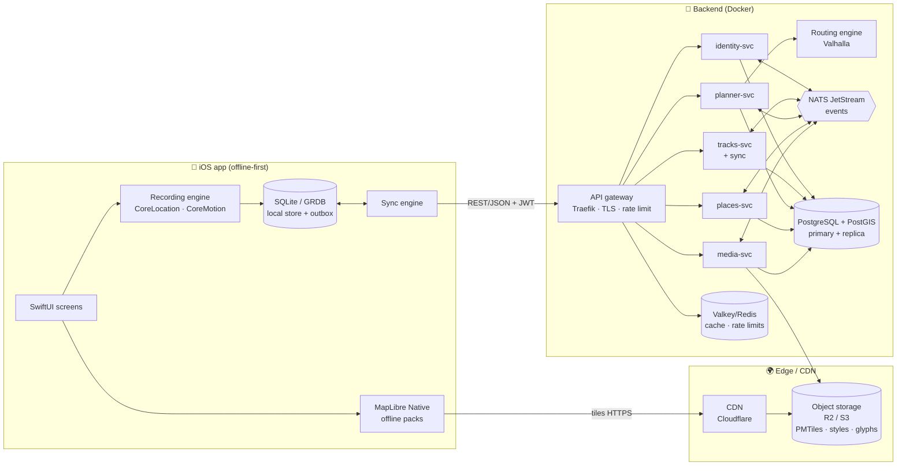
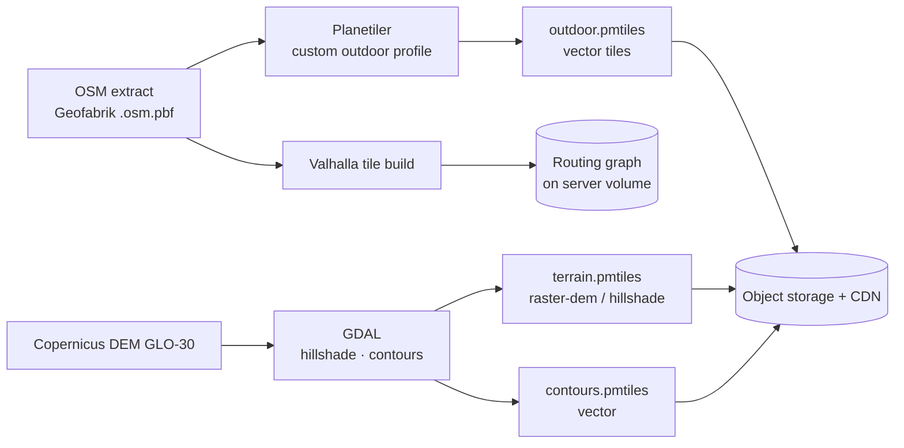
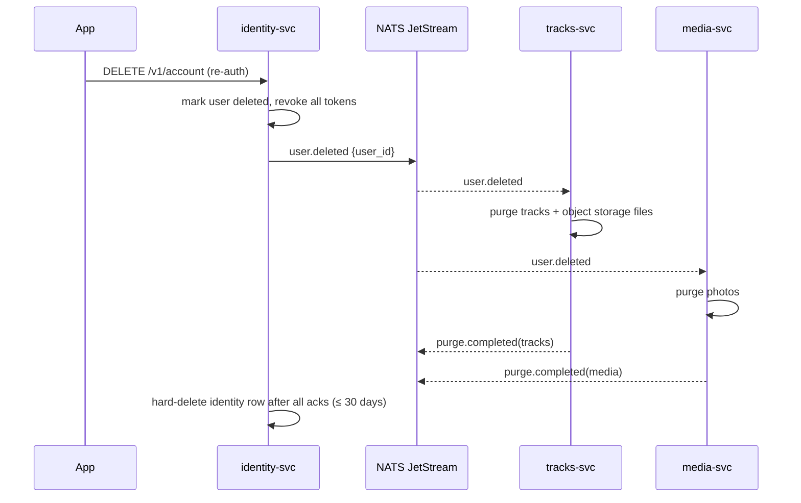
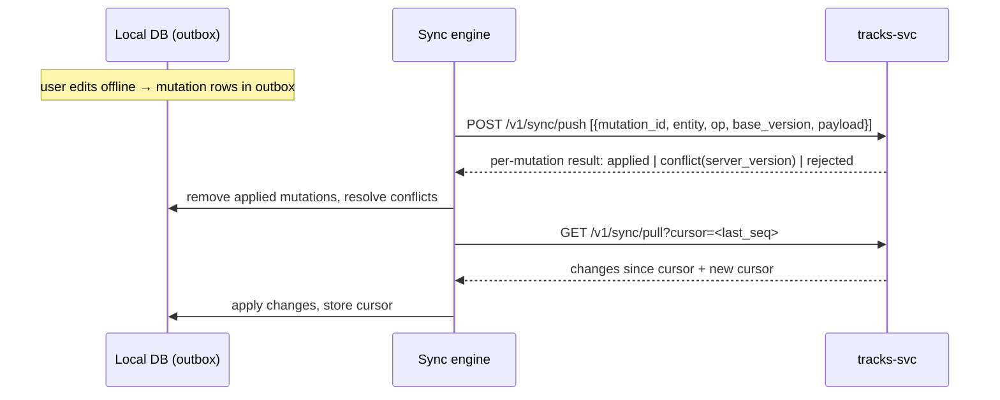

# Aret — Architecture & Technical Specification

> Open-source, privacy-first, offline-first hiking & mountain companion.
> Status: **Draft v0.2** · Date: 2026-11-15 · Decisions so far: ADR-0004, 0007, 0013, 0014 · Audience: core team (2 developers)

---

## Table of contents

1. [Vision & principles](#1-vision--principles)
2. [Scope & roadmap](#2-scope--roadmap)
3. [High-level architecture](#3-high-level-architecture)
4. [iOS client](#4-ios-client)
5. [Maps, terrain & routing data](#5-maps-terrain--routing-data)
6. [Backend services (Rust)](#6-backend-services-rust)
7. [Data layer](#7-data-layer)
8. [Offline sync protocol](#8-offline-sync-protocol)
9. [Authentication & security](#9-authentication--security)
10. [GDPR compliance](#10-gdpr-compliance)
11. [Deployment, orchestration & consistency](#11-deployment-orchestration--consistency)
12. [Observability](#12-observability)
13. [Repositories & GitHub organization](#13-repositories--github-organization)
14. [Licensing](#14-licensing)
15. [Costs & funding](#15-costs--funding)
16. [Open decisions (ADR backlog)](#16-open-decisions-adr-backlog)

---

## 1. Vision & principles

| Principle | What it means in practice |
|---|---|
| **Offline-first** | The app is fully usable with no signal: record, navigate, view maps, view saved tours. The server is a sync & sharing layer, not a dependency. |
| **Device does the work** | Recording, stats, elevation smoothing, map rendering happen on device. The backend stores, syncs, routes and shares. Keeps hosting cheap. |
| **Privacy by default** | Tracks are private by default; location data is treated as sensitive personal data. No ad SDKs, no third-party trackers. |
| **Open data, open source** | Built on OpenStreetMap, open DEMs and open-source engines. No proprietary map vendor lock-in. |
| **Cheap to run** | Static map tiles on object storage + CDN; small Rust services; one VM at the start. |
| **Grow incrementally** | Start with few services and split when there is a reason (load, team, deployment cadence). |

---

## 2. Scope & roadmap

### Phase 0 — Foundations (weeks 1–3)
- GitHub org, repos, project board, CI, issue templates, licenses.
- Tile pipeline producing the **pilot region — Alpi Apuane + Appennino tosco-emiliano** (ADR-0014) as PMTiles.
- Backend skeleton: `identity` + `tracks` services, Postgres/PostGIS, Docker Compose.

### Phase 1 — MVP "Record & keep" (≈ 2–3 months)
- iOS: map view (online + downloaded region), GPS recording with background mode, barometric elevation, live stats (distance, ascent/descent, time, pace), auto-pause.
- Local storage of tracks; GPX import/export.
- Account (email + password, Sign in with Apple), token auth.
- Sync of tracks to the server; view history on another device.

### Phase 2 — "Plan & go"
- Route planner (server-side routing engine with hiking profile, SAC scale filter).
- Elevation profile, time estimation (DIN 33466 / Swiss hiking time formula).
- Offline region download manager; turn-by-turn-ish off-route alerts.
- POIs: huts, peaks, springs, shelters, viewpoints (from OSM).

### Phase 3 — "Share"
- Public/unlisted tours, share links, photos on tracks.
- Follow friends, activity feed, live location sharing with a trusted contact (safety feature).
- Web viewer for shared tours.

### Phase 4 — "Expand"
- Apple Watch app, HealthKit heart rate.
- On-device (offline) routing.
- Android client, web planner.
- Weather/avalanche bulletin overlays (where licenses allow).

---

## 3. High-level architecture



**Key idea:** the heaviest traffic (map tiles) never touches your servers — it goes from object storage through a CDN. Your Rust services only handle small JSON payloads (auth, track sync, route requests), which keeps latency low and costs near zero.

### Request paths

| Use case | Path | Latency target |
|---|---|---|
| Show map | Device cache → CDN → object storage | < 100 ms (cached), 0 ms offline |
| Record hike | Device only | real time, no network |
| Sync track | App → Gateway → tracks-svc → Postgres (+ event) | async, background |
| Plan route | App → Gateway → planner-svc → Valhalla | < 500 ms p95 |
| Login / refresh | App → Gateway → identity-svc | < 200 ms p95 |
| Every other authenticated call | JWT verified **locally** in each service (no auth round-trip) | +< 1 ms |

---

## 4. iOS client

### 4.1 Stack

| Concern | Choice | Notes |
|---|---|---|
| UI | **SwiftUI**, iOS 18+ / watchOS 11+, Swift 6 (ADR-0013) | Observation framework (`@Observable`). Project generated with XcodeGen from `project.yml`. |
| Map rendering | **MapLibre Native iOS** | Open source, vector tiles, custom styles, offline packs, hillshade. Apple MapKit cannot render your own vector tiles/offline regions well. Decided in ADR-0004; the prototype's MapKit fallback stays until our offline maps are field-tested. |
| Local DB | **GRDB.swift** (SQLite) | Full SQL control, migrations, built-in **R\*Tree** spatial index for bbox queries, WAL mode, observable queries. SwiftData is fine for simple models but weaker for large point series and spatial queries. Decided in ADR-0007: replaces the prototype's JSON/GPX files; schema kept as plain `.sql` migrations so a future Android app (Room/SQLDelight) can reuse it. |
| Networking | `URLSession` + **swift-openapi-generator** | Client generated from the backend's OpenAPI spec → no hand-written DTOs. |
| Secrets | **Keychain** | Refresh token, never in UserDefaults. |
| Background work | `BGTaskScheduler`, background URLSession | Uploads continue when the app is suspended. |
| Crash reporting | Sentry (self-hostable) or MetricKit | Avoid Firebase for privacy. |

### 4.2 Module layout (local Swift packages)

```
AretApp (app target, SwiftUI composition root)
├── AretCore         – domain models (Track, TrackPoint, Tour, POI), units, formatters
├── AretPersistence  – GRDB database, migrations, repositories, outbox
├── AretLocation     – recording engine: GPS + barometer fusion, auto-pause, filters
├── AretMap          – MapLibre wrapper, styles, offline region manager
├── AretSync         – push/pull sync engine, conflict resolution
├── AretAPI          – generated OpenAPI client + auth interceptor (token refresh)
└── AretFeatures/*   – Record, Map, Plan, History, Profile feature modules
```

### 4.3 Sensors

| Sensor | API | Use |
|---|---|---|
| GPS | `CLLocationUpdate.liveUpdates()` (iOS 17), `CLBackgroundActivitySession` | Position; `activityType = .fitness`; adaptive accuracy to save battery. |
| Barometer | `CMAltimeter` relative + absolute altitude | Far better ascent/descent than GPS altitude. Fuse: barometer for *changes*, GPS/DEM for *absolute* offset. |
| Motion | `CMMotionActivityManager`, `CMPedometer` | Auto-pause when stationary, step count, cadence. |
| Compass | `CLLocationManager` heading | Map orientation, "which peak is that" (later). |
| Health (opt-in) | HealthKit | Write workouts; read heart rate from Watch (Phase 4). Special-category data → stays on device unless explicitly consented. |

### 4.4 Recording engine (crash-safe)

1. Points are appended to a `recording_points` table every few seconds (WAL, small transactions) → nothing is lost if the app is killed or the battery dies.
2. Filtering pipeline: discard low-accuracy fixes (`horizontalAccuracy > 30 m`), Kalman/moving-average smoothing, speed outlier rejection.
3. On finish: compute stats, Douglas-Peucker simplified geometry for display, write the `Track` row, enqueue an outbox `CreateTrack` mutation.
4. Raw points are kept on device; the full-resolution track is uploaded compressed.

### 4.5 Offline maps on device

- User picks a region (bbox or "download along this tour" with a buffer) and zoom range (e.g. z8–z15).
- MapLibre offline pack downloads vector tiles from **your CDN** (never from `tile.openstreetmap.org`, whose usage policy forbids bulk/offline download).
- Show estimated size before download; cap storage; let the user delete regions.
- Styles, fonts (glyphs) and sprites are bundled in the app so maps render offline from day one.

---

## 5. Maps, terrain & routing data

You don't need a map server — **maps are static files**.

### 5.1 Pipeline (repo `aret-maps`)



| Piece | Tool | Why |
|---|---|---|
| Vector tiles | **Planetiler** (Java, very fast) with a custom **outdoor profile** | Standard schemas (OpenMapTiles) drop most hiking attributes. A custom layer keeps `sac_scale`, `trail_visibility`, `surface`, hiking route relations (`route=hiking`, `network=iwn/nwn/rwn/lwn`), huts, springs, peaks, saddles, shelters. |
| Tile format | **PMTiles** | One file per layer, served by plain HTTP range requests from object storage. No tile server to run. |
| Elevation | **Copernicus DEM GLO-30** (30 m, free) | Hillshade, contour lines, elevation profiles, correction of GPS altitude. |
| Style | MapLibre style JSON in `aret-maps/styles` | Your own "outdoor" look: trails colored by difficulty, contours, hillshade. |
| Refresh | Weekly/monthly GitHub Action or cron on the VM | Rebuild from fresh OSM extract. |

Start with the **pilot region: Alpi Apuane + Appennino tosco-emiliano** (ADR-0014), small enough for free storage tiers; expand later.

### 5.2 Routing engine

Don't write a routing engine in Rust — run a proven one as a container behind `planner-svc`.

| Engine | License | Pros | Cons |
|---|---|---|---|
| **Valhalla** (recommended) | MIT | Pedestrian costing with `max_hiking_difficulty` (SAC scale), elevation-aware, small tiles, can later run **on-device** for offline routing. | C++ build, config learning curve. |
| GraphHopper | Apache-2.0 | Great hiking profiles, custom models, easy Docker. | JVM memory footprint. |
| BRouter | MIT | Excellent hiking profiles, proven offline on mobile. | Smaller community, Java. |

### 5.3 Data licenses to respect
- **OSM (ODbL):** visible attribution "© OpenStreetMap contributors" on the map; derived *databases* you publish must stay ODbL.
- **Copernicus DEM:** free use with attribution.
- Third-party overlays (weather, avalanche) — check each license before integrating.

---

## 6. Backend services (Rust)

### 6.1 Common stack

| Concern | Crate / tool |
|---|---|
| HTTP | `axum` + `tokio` + `tower` (timeouts, compression, rate limits) |
| DB | `sqlx` (async, compile-time checked SQL) + `sqlx migrate` |
| Geo | `geo`, `geozero` (PostGIS ⇄ geo types), `gpx` |
| OpenAPI | `utoipa` (spec generated from code → Swift client generated from spec) |
| Auth | `argon2`, `jsonwebtoken` (EdDSA), later `webauthn-rs` for passkeys |
| Events | `async-nats` (JetStream) |
| Storage | `object_store` or `aws-sdk-s3` (works with R2/MinIO) |
| Telemetry | `tracing` + `tracing-opentelemetry` |
| Config | `figment` or `config` + env vars; secrets via files/env injected at deploy |
| Testing | `testcontainers` (real Postgres in integration tests), `insta` snapshots |
| Supply chain | `cargo-deny` (licenses, advisories), `cargo-audit` |

### 6.2 Services

> **Recommendation for 2 developers:** a *Cargo workspace monorepo* with one binary per service and shared crates. You get microservice deployment (separate containers, scale independently) without the overhead of N repositories and N CI pipelines. Start with the **bold** services; the rest arrive with their phase.

| Service | Phase | Responsibility | Owns (Postgres schema) | Publishes events |
|---|---|---|---|---|
| **identity-svc** | 1 | Sign-up, login, Sign in with Apple, token issue/refresh/revoke, email verification, password reset, account deletion, JWKS endpoint | `identity` | `user.created`, `user.deleted` |
| **tracks-svc** | 1 | Upload/download tracks, stats, sync endpoints (push/pull), GPX import/export, privacy zones | `tracks` | `track.created`, `track.updated`, `track.deleted` |
| planner-svc | 2 | Route planning (proxy + enrichment of Valhalla), saved tours, elevation profile, time estimate | `planner` | `tour.created` |
| places-svc | 2 | POI search (huts, peaks, water), geocoding of mountain names (from OSM import) | `places` | — |
| media-svc | 3 | Photo upload via pre-signed URLs, thumbnails, EXIF stripping (removes GPS/device metadata unless user opts in) | `media` | `media.uploaded` |
| social-svc | 3 | Follows, feed, likes/comments, share links, visibility | `social` | `feed.*` |
| live-svc | 3 | Live location sharing over WebSocket for safety contacts | Valkey (ephemeral) | — |
| worker | 1+ | Async jobs consuming events: DEM elevation correction, stats recomputation, GDPR purge, emails | — | — |

**Gateway:** **Traefik** (or Caddy) — TLS via Let's Encrypt, path routing (`/v1/auth/*` → identity, `/v1/tracks/*` → tracks…), rate limiting, request size limits. No custom Rust gateway needed.

### 6.3 API conventions
- REST + JSON, versioned under `/v1`. OpenAPI 3.1 published per service, merged in CI.
- IDs: **UUIDv7** generated on the client (time-ordered, allows offline creation, no ID conflicts).
- Idempotency: every mutating request carries `Idempotency-Key` (= client mutation ID).
- Pagination: cursor-based. Errors: RFC 9457 `application/problem+json`.
- Large payloads (full-res track points): gzip-compressed GeoJSON or a compact binary encoding (protobuf/FlatBuffers) — start with gzip JSON, optimize later.

### 6.4 Event flow example — account deletion (GDPR)



Events use the **transactional outbox pattern** in each service (write event to an `outbox` table in the same DB transaction, a relay publishes to NATS) so no event is lost if a service crashes.

---

## 7. Data layer

### 7.1 Why PostgreSQL + PostGIS (confirmed)

Your instinct is right. **PostgreSQL with the PostGIS extension** is the standard for geospatial data:
- Native geometry types (`LINESTRING Z M` = lon/lat + elevation + timestamp), spatial indexes (GiST), functions like `ST_Length`, `ST_Simplify`, `ST_Intersects`, `ST_DWithin` ("tours near me").
- `JSONB` handles the heterogeneous parts (device metadata, sensor extras, OSM tags) without a separate document DB.
- Mature replication, backups, operators for Kubernetes.

What you do **not** need at the start: MongoDB, a dedicated time-series DB, Elasticsearch. Postgres covers it (full-text search via `tsvector` + `pg_trgm` for place names).

| Store | Purpose |
|---|---|
| **PostgreSQL 17 + PostGIS** | Users, tracks (metadata + simplified geometry), tours, POIs, social graph |
| **Object storage** (R2/S3/MinIO) | Full-resolution tracks (gzip), GPX exports, photos, PMTiles map files |
| **Valkey** (Redis fork, BSD) | Rate limits, short-lived caches, live-location pub/sub |
| **NATS JetStream** | Durable event stream between services |

### 7.2 Core schema sketch

```sql
-- identity schema
CREATE TABLE identity.users (
  id              uuid PRIMARY KEY,               -- UUIDv7
  email_enc       bytea NOT NULL,                 -- encrypted (AES-256-GCM, envelope key)
  email_hash      bytea NOT NULL UNIQUE,          -- HMAC-SHA256 blind index for lookup
  password_hash   text,                           -- Argon2id PHC string; NULL for Apple-only users
  apple_sub       text UNIQUE,
  email_verified  boolean NOT NULL DEFAULT false,
  created_at      timestamptz NOT NULL DEFAULT now(),
  deleted_at      timestamptz
);

CREATE TABLE identity.refresh_tokens (
  id          uuid PRIMARY KEY,
  user_id     uuid NOT NULL REFERENCES identity.users(id),
  family_id   uuid NOT NULL,                      -- rotation family for reuse detection
  token_hash  bytea NOT NULL UNIQUE,              -- SHA-256 of opaque token, never the token
  device_name text,
  expires_at  timestamptz NOT NULL,
  revoked_at  timestamptz
);

-- tracks schema
CREATE TABLE tracks.tracks (
  id              uuid PRIMARY KEY,               -- generated on device
  owner_id        uuid NOT NULL,                  -- no cross-schema FK (service boundary)
  title           text,
  sport           text NOT NULL DEFAULT 'hike',
  visibility      text NOT NULL DEFAULT 'private' CHECK (visibility IN ('private','unlisted','followers','public')),
  started_at      timestamptz NOT NULL,
  ended_at        timestamptz NOT NULL,
  distance_m      double precision NOT NULL,
  ascent_m        double precision NOT NULL,
  descent_m       double precision NOT NULL,
  moving_time_s   integer NOT NULL,
  geom_simplified geometry(LineStringZ, 4326) NOT NULL,  -- for map display/search
  raw_object_key  text,                           -- full-res points in object storage
  start_cell      text,                           -- coarse geohash for privacy-zone logic
  extra           jsonb NOT NULL DEFAULT '{}',    -- device, sensor flags, weather…
  version         bigint NOT NULL DEFAULT 1,      -- for sync / optimistic concurrency
  updated_at      timestamptz NOT NULL DEFAULT now(),
  deleted_at      timestamptz                     -- tombstone for sync
);
CREATE INDEX ON tracks.tracks USING gist (geom_simplified);
CREATE INDEX ON tracks.tracks (owner_id, updated_at);

CREATE TABLE tracks.privacy_zones (
  id        uuid PRIMARY KEY,
  owner_id  uuid NOT NULL,
  center    geography(Point) NOT NULL,           -- stored encrypted at rest (volume)
  radius_m  integer NOT NULL CHECK (radius_m BETWEEN 200 AND 2000)
);

-- per-user monotonic change log, drives sync pull
CREATE TABLE tracks.changes (
  seq        bigserial PRIMARY KEY,
  owner_id   uuid NOT NULL,
  entity     text NOT NULL,                       -- 'track' | 'tour' | ...
  entity_id  uuid NOT NULL,
  op         text NOT NULL,                       -- 'upsert' | 'delete'
  at         timestamptz NOT NULL DEFAULT now()
);
CREATE INDEX ON tracks.changes (owner_id, seq);
```

**Database-per-service, pragmatically:** at the start, one Postgres cluster with **one schema and one DB role per service** (a service can only touch its own schema). When a service needs its own cluster, move the schema — no code change.

---

## 8. Offline sync protocol

The mobile device is the biggest source of eventual consistency (it can be offline for days), so sync is a first-class design element.



Rules:
- **Client-generated UUIDv7** → creating offline never collides.
- **Push is idempotent** (`mutation_id` = idempotency key) → retries are safe on flaky mountain networks.
- **Tracks are append-only/immutable after recording** → almost no conflicts. Only metadata (title, visibility, notes) can conflict → **last-writer-wins per field** using a hybrid logical clock timestamp.
- **Deletes are tombstones** (`deleted_at`), purged after all devices have synced past them (or after 90 days).
- Uploads of full-resolution points go via **pre-signed object-storage URLs** with background `URLSession`; the API call only registers the object key.
- Sync triggers: app foreground, after recording ends, `BGAppRefreshTask`, network becomes available (`NWPathMonitor`), Wi-Fi-only option for large uploads.

---

## 9. Authentication & security

### 9.1 Token model

| Token | Format | Lifetime | Storage on device |
|---|---|---|---|
| Access token | **JWT signed with Ed25519 (EdDSA)**; claims: `sub`, `exp`, `iat`, `jti`, `scope` | 15 min | memory |
| Refresh token | Opaque random 256-bit, stored **hashed** on server | 30 days, **rotated** on every use | Keychain (`kSecAttrAccessibleAfterFirstUnlockThisDeviceOnly`) |

- Services verify JWTs **locally** using the public keys from identity-svc's JWKS endpoint (cached) → no per-request call to identity → fast.
- **Refresh token rotation with reuse detection:** if an old refresh token is reused, revoke the whole family (stolen token).
- Key rotation: `kid` header, two active keys during rotation.
- Revocation of access tokens is implicit by short TTL; for "log out everywhere" add a `tokens_valid_after` timestamp per user, cached in Valkey.

### 9.2 Credentials
- Passwords: **Argon2id** (OWASP baseline: m = 19 MiB, t = 2, p = 1; tune upwards on your hardware), per-user salt (built into PHC string), optional server-side **pepper** from secrets.
- Rate limit login and reset endpoints (per IP + per account), generic error messages (no user enumeration).
- **Sign in with Apple** from Phase 1: frictionless on iOS, and App Store guidelines require it if you ever add other third-party logins.
- **Passkeys (WebAuthn)** in Phase 2–3 — excellent on iOS, removes password risk entirely.
- Email verification and password-reset tokens: single-use, short-lived, stored hashed.

### 9.3 Data protection
- **In transit:** TLS 1.3 everywhere (Let's Encrypt at the gateway); mTLS or a private network between services when on multiple hosts. iOS App Transport Security enforced.
- **At rest:** encrypted disks/volumes; encrypted backups (WAL-G/pgBackRest with encryption); object storage server-side encryption.
- **Field-level:** sensitive fields (email, privacy-zone centers) encrypted with AES-256-GCM using **envelope encryption** (data key encrypted by a master key); email lookup via an HMAC blind index.
- **Secrets:** SOPS + age in the infra repo at the start; OpenBao/Vault or cloud KMS later. Never in images or git plaintext.
- **On device:** iOS Data Protection (`completeUntilFirstUserAuthentication`) for the SQLite file.
- **Supply chain:** Dependabot, `cargo-deny`, CodeQL, signed container images (cosign), minimal images (`distroless` or `scratch` with musl).
- `SECURITY.md` with a responsible-disclosure contact.

---

## 10. GDPR compliance

Location traces are personal data and can reveal home, work, health and habits. Design for it:

| GDPR requirement | Implementation |
|---|---|
| Lawful basis (Art. 6) | Contract for core service; **explicit opt-in consent** for optional processing (analytics, public sharing). |
| Special category data (Art. 9) | Heart rate / health data → explicit consent, kept on device by default. |
| Data minimisation | Collect only email + what's needed; no IP logs beyond 7–14 days; no ad/analytics SDKs (or self-hosted, cookieless analytics only). |
| Privacy by default (Art. 25) | Tracks **private** by default; **privacy zones** hide start/end near home; EXIF GPS stripped from photos. |
| Right of access & portability (Art. 15, 20) | "Export my data" → ZIP with JSON + GPX files, generated by worker, link e-mailed. |
| Right to erasure (Art. 17) | Account deletion flow (§6.4), backups expire within retention window (e.g. 30 days). |
| Retention | Documented retention per data type; tombstones and logs purged automatically. |
| Processors (Art. 28) | Sign DPAs with hosting/email/storage providers; prefer **EU-hosted** providers (Hetzner, Scaleway, OVH); Cloudflare offers DPA + EU data localization options. |
| Records & transparency (Art. 13, 30) | Privacy policy, record of processing activities in `aret-docs`, App Store privacy "nutrition label". |
| Breach notification (Art. 33) | Incident runbook: notify authority within 72 h. |
| Age | Minimum age (16 in most EU states without parental consent) stated in ToS. |

---

## 11. Deployment, orchestration & consistency

### 11.1 Staged approach (don't start with Kubernetes)

| Stage | Users | Setup | Orchestration |
|---|---|---|---|
| **0 – Dev** | you two | Docker Compose on laptops (Postgres, NATS, Valkey, MinIO, services) | Compose |
| **1 – Beta** | < 1k | **One VM** (e.g. Oracle Cloud Always Free ARM 4 vCPU/24 GB, or Hetzner CAX ~€4–8/month) running Docker Compose + Traefik; tiles on R2 + Cloudflare CDN | Compose + `restart: unless-stopped`, health checks, nightly off-site backups |
| **2 – Growth** | 1k–50k | 3 small nodes, **k3s** (lightweight Kubernetes); Postgres via **CloudNativePG** (primary + 1–2 streaming replicas, automatic failover); services with 2+ replicas | k3s + Helm/Kustomize, GitOps with Argo CD or Flux |
| **3 – Scale** | 50k+ | Managed Kubernetes or more nodes, multi-AZ, read replicas per region | Kubernetes, HPA autoscaling |

Kubernetes from day one would cost you weeks of ops work and money with no user benefit. Containerize everything from the start so moving from Compose to k3s is mostly writing manifests.

### 11.2 Consistency model (fast real time first, eventually consistent)

Not every piece of data should be eventually consistent. Split it:

| Data | Consistency | Why |
|---|---|---|
| Accounts, credentials, tokens, payments | **Strong** – writes & reads on the Postgres **primary** | A stale replica must never accept a revoked token or a changed password. |
| User's own tracks/tours (right after writing) | **Read-your-writes** – route that user's reads to the primary for a few seconds, or compare the replica's replayed LSN | Avoids "I saved it and it's gone". |
| Feeds, public tours, POI search, stats | **Eventual** – read replicas, caches, async event consumers | High volume, staleness of seconds is fine. |
| Device ⇄ server | **Eventual** – sync protocol (§8) | Offline by nature. |

Single-primary + async replicas is the right model for years. Avoid multi-master Postgres; it adds conflict resolution problems you don't need.

### 11.3 CI/CD
- GitHub Actions: `fmt` → `clippy -D warnings` → tests (testcontainers) → `cargo-deny` → build **multi-arch** images (amd64 + arm64) → push to **GHCR** → deploy (SSH + `docker compose pull && up -d` in Stage 1; Argo CD in Stage 2).
- iOS: SwiftLint + `xcodebuild test` on macOS runners (free for public repos) → **fastlane** / Xcode Cloud to TestFlight on tags.
- Releases: Conventional Commits + `release-please` for changelogs and semver tags.

---

## 12. Observability

| Signal | Tool |
|---|---|
| Logs | `tracing` JSON → Loki (no personal data in logs; user IDs hashed) |
| Metrics | Prometheus (`/metrics` per service) → Grafana |
| Traces | OpenTelemetry → Tempo |
| Uptime | Uptime Kuma (self-hosted) or a free external checker |
| Mobile | MetricKit / Sentry (self-hostable), opt-in |

Grafana Cloud's free tier covers Stage 1; self-host the LGTM stack in Stage 2.

---

## 13. Repositories & GitHub organization

### 13.1 Organization
Create a GitHub organization (e.g. `aret-app` — check availability), both of you as owners. Teams: `core`, `ios`, `backend`, `maps` (useful later for `CODEOWNERS` and contributor permissions).

### 13.2 Repositories

| Repo | Content | License |
|---|---|---|
| `.github` | Org profile README, default `CONTRIBUTING.md`, `CODE_OF_CONDUCT.md`, `SECURITY.md`, **issue forms** and PR template inherited by all repos, `FUNDING.yml` | CC-BY-4.0 / MIT |
| `aret-ios` | Xcode project, local Swift packages (§4.2), fastlane | MPL-2.0 |
| `aret-backend` | Cargo workspace: `services/*`, `crates/*` (shared), migrations, OpenAPI | AGPL-3.0 |
| `aret-maps` | Planetiler profile, MapLibre styles, sprites/glyphs, DEM scripts, Valhalla config, build workflows | BSD-3 / data under ODbL |
| `aret-infra` | Docker Compose, k3s manifests/Helm, Traefik config, SOPS secrets, Terraform/OpenTofu, runbooks | AGPL-3.0 or MIT |
| `aret-docs` | This spec, ADRs (`docs/adr/0001-…md`), privacy policy, GDPR records, user docs site | CC-BY-4.0 |
| `aret-web` *(Phase 3)* | Shared-tour viewer, later web planner | AGPL-3.0 |
| `aret-android` *(Phase 4)* | Android client | MPL-2.0 |

`aret-backend` layout:

```
aret-backend/
├── Cargo.toml              # [workspace]
├── crates/
│   ├── aret-common/        # config, errors (problem+json), telemetry, db pool
│   ├── aret-auth/          # JWT verification middleware, JWKS cache, claims
│   ├── aret-geo/           # GPX parse/write, simplification, stats, elevation smoothing
│   ├── aret-events/        # event schemas + outbox relay
│   └── aret-crypto/        # envelope encryption, blind index
├── services/
│   ├── identity/           # src/, migrations/, Dockerfile
│   ├── tracks/
│   ├── planner/
│   ├── places/
│   ├── media/
│   └── worker/
├── openapi/                # merged spec published as CI artifact → consumed by aret-ios
├── compose.yaml            # local dev stack
└── .github/workflows/
```

### 13.3 Centralized tracking with GitHub Projects

One **organization-level GitHub Project** ("Aret Roadmap") collects issues from all repos.

- **Auto-add:** project workflow (or `actions/add-to-project`) adds new issues/PRs from every repo.
- **Custom fields:** `Status` (Backlog → Ready → In progress → In review → Done), `Priority` (P0–P3), `Area` (iOS, Backend, Maps, Infra, Docs, Design), `Size` (XS–XL), `Iteration` (2-week sprints), `Phase` (0–4).
- **Views:**
  - *Board* — kanban by Status, filtered to current iteration.
  - *Roadmap* — timeline by Iteration/Phase.
  - *Bugs* — table, `type:bug`, sorted by Priority.
  - *My work* — `assignee:@me`.
- **Labels (synced across repos** with a label-sync action from `.github`): `type:bug`, `type:feature`, `type:chore`, `type:security`, `area:*`, `good first issue`, `help wanted`, `needs-triage`.
- **Issue forms** in `.github/ISSUE_TEMPLATE/`: Bug report (device, iOS version, steps, GPX attachment), Feature request, Map data issue (often an OSM fix → link to OSM).
- **Milestones** per release (`v0.1 MVP`, …) in each repo.
- **Discussions** enabled on `.github` or `aret-docs` for ideas, RFCs and community Q&A; promote accepted ideas to issues.
- **Repo hygiene:** branch protection on `main` (PR + 1 review + green CI), `CODEOWNERS`, Dependabot, CodeQL, secret scanning, squash merges.
- **Architecture decisions:** each significant choice becomes an ADR PR in `aret-docs`, linked from the project.

---

## 14. Licensing

- **Backend: AGPL-3.0** — anyone who runs a modified version as a public service must publish their changes. Protects you from a closed-source commercial clone of your hosted service while staying fully open.
- **iOS app: MPL-2.0** (file-level copyleft). GPL-family licenses have a known conflict with App Store terms; MPL avoids that while keeping modifications open.
- **Contributions:** use the **DCO** (`Signed-off-by`) — lightweight. If you think you may need to relicense later (e.g. dual licensing), decide on a CLA *before* accepting outside contributions.
- **Data:** OSM-derived data stays ODbL with attribution.

---

## 15. Costs & funding

### 15.1 Estimated running costs (verify current provider terms)

| Item | Stage 1 (beta) | Stage 2 (growth) |
|---|---|---|
| Apple Developer Program | **$99 / year (unavoidable)** | $99 / year |
| Compute | €0 (Oracle Always Free) – €8/month (Hetzner ARM) | €30–80/month (3 nodes) |
| Object storage + CDN (tiles, tracks) | €0 (Cloudflare R2 free tier ~10 GB, no egress fees) | €5–30/month |
| Postgres | on the VM (or Supabase/Neon free tier, both support PostGIS) | CloudNativePG on cluster |
| Container registry, CI | €0 (GHCR + Actions, public repos) | €0 |
| Monitoring | €0 (Grafana Cloud free) | self-hosted |
| Email (verification/reset) | €0 (free tiers of transactional email providers) | €10–20/month |
| Domain | ~€10–15 / year | same |
| **Total** | **≈ €10–20/month** | **≈ €60–150/month** |

### 15.2 Funding model
1. **Donations:** GitHub Sponsors + Open Collective (transparent expenses, builds community trust).
2. **Freemium later**, keep the core free and open: everything works offline and locally for free; a small **"Aret Supporter"** subscription (~€1–3/month or ~€15–25/year) for cloud features that cost money: unlimited sync storage, photo storage, multi-device, live tracking, larger offline regions. Apple takes 15% (Small Business Program).
3. Self-hosting stays possible for anyone (AGPL), which is good for trust.

---

## 16. Open decisions (ADR backlog)

| # | Decision | Recommendation in this spec | Status |
|---|---|---|---|
| 0001 | Backend language | Rust (axum, sqlx) | Proposed |
| 0002 | Database | PostgreSQL + PostGIS | Proposed |
| 0003 | Service granularity | Cargo workspace monorepo; start with identity + tracks + worker | Proposed |
| 0004 | Map rendering on iOS | MapLibre Native, MapKit fallback until offline maps are tested | **Accepted** |
| 0005 | Tile format & hosting | PMTiles on R2 + CDN, Planetiler custom outdoor profile | Proposed |
| 0006 | Routing engine | Valhalla | Proposed |
| 0007 | iOS persistence | GRDB, schema as plain SQL migrations | **Accepted** |
| 0008 | Auth | Own identity-svc (Argon2id, EdDSA JWT, rotating refresh) + Sign in with Apple; *alternative: self-host Zitadel/Ory Kratos* | Proposed |
| 0009 | Event bus | NATS JetStream | Proposed |
| 0010 | Orchestration | Compose → k3s + CloudNativePG | Proposed |
| 0011 | Licenses | AGPL-3.0 backend, MPL-2.0 iOS, DCO | Proposed |
| 0012 | Hosting region | EU (GDPR) | Proposed |
| 0013 | Minimum iOS version | iOS 18 / watchOS 11 (as in the prototype) | **Accepted** |
| 0014 | First map region | Alpi Apuane + Appennino tosco-emiliano | **Accepted** |

### Immediate next steps
1. Review this document together; turn each row above into an ADR (accept / change).
2. Create the GitHub org, `.github` repo, project board and labels.
3. Audit the existing iOS prototype against §4 (persistence, map SDK, module structure).
4. Build the first PMTiles region and render it in the prototype with MapLibre — the riskiest, most visible piece; do it first.
5. Backend skeleton: `identity` + `tracks` with Compose, OpenAPI → Swift client generation end-to-end.
