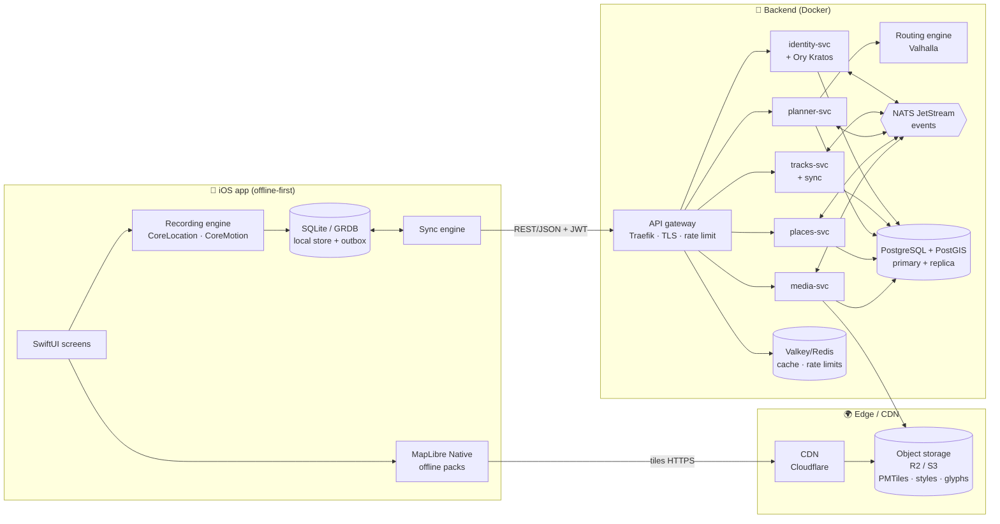
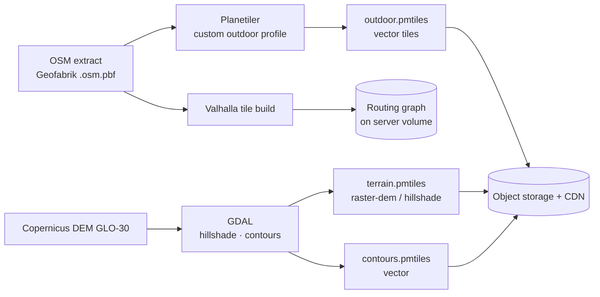
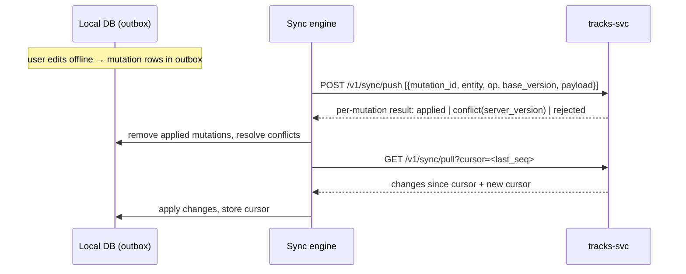

# Aret — Architecture & Technical Specification

> Open-source, privacy-first, offline-first hiking & mountain companion.
> Status: **Draft v0.3** · Date: 2026-11-15 · Decisions so far: ADR-0001–0005, 0007–0009, 0011, 0013, 0014 · Audience: core team (2 developers)

---

## Table of contents

1. [Vision & principles](#1-vision--principles)
2. [Scope & roadmap](#2-scope--roadmap)
3. [High-level architecture](#3-high-level-architecture)
4. [iOS client](#4-ios-client)
5. [Maps, terrain & routing data](#5-maps-terrain--routing-data)
6. [Backend services (Rust)](#6-backend-services-rust)
7. [Data layer](#7-data-layer)
8. [Offline sync protocol](#8-offline-sync-protocol)
9. [Authentication & security](#9-authentication--security)
10. [GDPR compliance](#10-gdpr-compliance)
11. [Deployment, orchestration & consistency](#11-deployment-orchestration--consistency)
12. [Observability](#12-observability)
13. [Repositories & GitHub organization](#13-repositories--github-organization)
14. [Licensing](#14-licensing)
15. [Costs & funding](#15-costs--funding)
16. [Open decisions (ADR backlog)](#16-open-decisions-adr-backlog)
17. [Implementation status (for AI agents and new contributors)](#17-implementation-status-for-ai-agents-and-new-contributors)

---

## 1. Vision & principles

| Principle | What it means in practice |
|---|---|
| **Offline-first** | The app is fully usable with no signal: record, navigate, view maps, view saved tours. The server is a sync & sharing layer, not a dependency. |
| **Device does the work** | Recording, stats, elevation smoothing, map rendering happen on device. The backend stores, syncs, routes and shares. Keeps hosting cheap. |
| **Privacy by default** | Tracks are private by default; location data is treated as sensitive personal data. No ad SDKs, no third-party trackers. |
| **Open data, open source** | Built on OpenStreetMap, open DEMs and open-source engines. No proprietary map vendor lock-in. |
| **Cheap to run** | Static map tiles on object storage + CDN; small Rust services; one VM at the start. |
| **Grow incrementally** | Start with few services and split when there is a reason (load, team, deployment cadence). |

---

## 2. Scope & roadmap

### Phase 0 — Foundations (weeks 1–3)
- GitHub org, repos, project board, CI, issue templates, licenses.
- Tile pipeline producing the **pilot region — Alpi Apuane + Appennino tosco-emiliano** (ADR-0014) as PMTiles.
- Backend skeleton: Ory Kratos + `identity` adapter + `tracks` service, Postgres/PostGIS, Docker Compose.

### Phase 1 — MVP "Record & keep" (≈ 2–3 months)
- iOS: map view (online + downloaded region), GPS recording with background mode, barometric elevation, live stats (distance, ascent/descent, time, pace), auto-pause.
- Local storage of tracks; GPX import/export.
- Account (email + password, Sign in with Apple), token auth.
- Sync of tracks to the server; view history on another device.

### Phase 2 — "Plan & go"
- Route planner (server-side routing engine with hiking profile, SAC scale filter).
- Elevation profile, time estimation (DIN 33466 / Swiss hiking time formula).
- Offline region download manager; turn-by-turn-ish off-route alerts.
- POIs: huts, peaks, springs, shelters, viewpoints (from OSM).

### Phase 3 — "Share"
- Public/unlisted tours, share links, photos on tracks.
- Follow friends, activity feed, live location sharing with a trusted contact (safety feature).
- Web viewer for shared tours.

### Phase 4 — "Expand"
- Apple Watch app, HealthKit heart rate.
- On-device (offline) routing.
- Android client, web planner.
- Weather/avalanche bulletin overlays (where licenses allow).

---

## 3. High-level architecture



**Key idea:** the heaviest traffic (map tiles) never touches your servers — it goes from object storage through a CDN. Your Rust services only handle small JSON payloads (auth, track sync, route requests), which keeps latency low and costs near zero.

### Request paths

| Use case | Path | Latency target |
|---|---|---|
| Show map | Device cache → CDN → object storage | < 100 ms (cached), 0 ms offline |
| Record hike | Device only | real time, no network |
| Sync track | App → Gateway → tracks-svc → Postgres (+ event) | async, background |
| Plan route | App → Gateway → planner-svc → Valhalla | < 500 ms p95 |
| Login / refresh | App → Gateway → Ory Kratos | < 200 ms p95 |
| Every other authenticated call | JWT verified **locally** in each service (no auth round-trip) | +< 1 ms |

---

## 4. iOS client

### 4.1 Stack

| Concern | Choice | Notes |
|---|---|---|
| UI | **SwiftUI**, iOS 18+ / watchOS 11+, Swift 6 (ADR-0013) | Observation framework (`@Observable`). Project generated with XcodeGen from `project.yml`. |
| Map rendering | **MapLibre Native iOS** | Open source, vector tiles, custom styles, offline packs, hillshade. Apple MapKit cannot render your own vector tiles/offline regions well. Decided in ADR-0004; the prototype's MapKit fallback stays until our offline maps are field-tested. |
| Local DB | **GRDB.swift** (SQLite) | Full SQL control, migrations, built-in **R\*Tree** spatial index for bbox queries, WAL mode, observable queries. SwiftData is fine for simple models but weaker for large point series and spatial queries. Decided in ADR-0007: replaces the prototype's JSON/GPX files; schema kept as plain `.sql` migrations so a future Android app (Room/SQLDelight) can reuse it. |
| Networking | `URLSession` + **swift-openapi-generator** | Client generated from the backend's OpenAPI spec → no hand-written DTOs. |
| Secrets | **Keychain** | Refresh token, never in UserDefaults. |
| Background work | `BGTaskScheduler`, background URLSession | Uploads continue when the app is suspended. |
| Crash reporting | Sentry (self-hostable) or MetricKit | Avoid Firebase for privacy. |

### 4.2 Module layout (local Swift packages)

```
AretApp (app target, SwiftUI composition root)
├── AretCore         – domain models (Track, TrackPoint, Tour, POI), units, formatters
├── AretPersistence  – GRDB database, migrations, repositories, outbox
├── AretLocation     – recording engine: GPS + barometer fusion, auto-pause, filters
├── AretMap          – MapLibre wrapper, styles, offline region manager
├── AretSync         – push/pull sync engine, conflict resolution
├── AretAPI          – generated OpenAPI client + auth interceptor (token refresh)
└── AretFeatures/*   – Record, Map, Plan, History, Profile feature modules
```

### 4.3 Sensors

| Sensor | API | Use |
|---|---|---|
| GPS | `CLLocationUpdate.liveUpdates()` (iOS 17), `CLBackgroundActivitySession` | Position; `activityType = .fitness`; adaptive accuracy to save battery. |
| Barometer | `CMAltimeter` relative + absolute altitude | Far better ascent/descent than GPS altitude. Fuse: barometer for *changes*, GPS/DEM for *absolute* offset. |
| Motion | `CMMotionActivityManager`, `CMPedometer` | Auto-pause when stationary, step count, cadence. |
| Compass | `CLLocationManager` heading | Map orientation, "which peak is that" (later). |
| Health (opt-in) | HealthKit | Write workouts; read heart rate from Watch (Phase 4). Special-category data → stays on device unless explicitly consented. |

### 4.4 Recording engine (crash-safe)

1. Points are appended to a `recording_points` table every few seconds (WAL, small transactions) → nothing is lost if the app is killed or the battery dies.
2. Filtering pipeline: discard low-accuracy fixes (`horizontalAccuracy > 30 m`), Kalman/moving-average smoothing, speed outlier rejection.
3. On finish: compute stats, Douglas-Peucker simplified geometry for display, write the `Track` row, enqueue an outbox `CreateTrack` mutation.
4. Raw points are kept on device; the full-resolution track is uploaded compressed.

### 4.5 Offline maps on device

- User picks a region (bbox or "download along this tour" with a buffer) and zoom range (e.g. z8–z15).
- MapLibre offline pack downloads vector tiles from **your CDN** (never from `tile.openstreetmap.org`, whose usage policy forbids bulk/offline download).
- Show estimated size before download; cap storage; let the user delete regions.
- Styles, fonts (glyphs) and sprites are bundled in the app so maps render offline from day one.

---

## 5. Maps, terrain & routing data

You don't need a map server — **maps are static files**.

### 5.1 Pipeline (repo `aret-maps`)



| Piece | Tool | Why |
|---|---|---|
| Vector tiles | **Planetiler** (Java, very fast) with a custom **outdoor profile** | Standard schemas (OpenMapTiles) drop most hiking attributes. A custom layer keeps `sac_scale`, `trail_visibility`, `surface`, hiking route relations (`route=hiking`, `network=iwn/nwn/rwn/lwn`), huts, springs, peaks, saddles, shelters. |
| Tile format | **Folder of vector tiles (`z/x/y.pbf`)** on **Cloudflare Pages** (ADR-0005) | Static files on a free global CDN, no card, no tile server. Pages allows 20,000 files of ≤ 25 MB each, enough for the pilot region. Later, for larger regions: one **PMTiles** file per layer on R2/S3, served with HTTP range requests. |
| Elevation | **Copernicus DEM GLO-30** (30 m, free) | Hillshade, contour lines, elevation profiles, correction of GPS altitude. |
| Style | MapLibre style JSON in `aret-maps/styles` | Your own "outdoor" look: trails colored by difficulty, contours, hillshade. |
| Refresh | Weekly/monthly GitHub Action or cron on the VM | Rebuild from fresh OSM extract. |

Start with the **pilot region: Alpi Apuane + Appennino tosco-emiliano** (ADR-0014), small enough for free storage tiers; expand later.

### 5.2 Routing engine

Don't write a routing engine in Rust — run a proven one as a container behind `planner-svc`.

| Engine | License | Pros | Cons |
|---|---|---|---|
| **Valhalla** (recommended) | MIT | Pedestrian costing with `max_hiking_difficulty` (SAC scale), elevation-aware, small tiles, can later run **on-device** for offline routing. | C++ build, config learning curve. |
| GraphHopper | Apache-2.0 | Great hiking profiles, custom models, easy Docker. | JVM memory footprint. |
| BRouter | MIT | Excellent hiking profiles, proven offline on mobile. | Smaller community, Java. |

### 5.3 Data licenses to respect
- **OSM (ODbL):** visible attribution "© OpenStreetMap contributors" on the map; derived *databases* you publish must stay ODbL.
- **Copernicus DEM:** free use with attribution.
- Third-party overlays (weather, avalanche) — check each license before integrating.
- **Route libraries** of other apps (Komoot, Wikiloc, AllTrails…) are proprietary databases: never copied. Pre-built routes come from open data (ADR-0015).

---

## 6. Backend services (Rust)

### 6.1 Common stack

| Concern | Crate / tool |
|---|---|
| HTTP | `axum` + `tokio` + `tower` (timeouts, compression, rate limits) |
| DB | `sqlx` (async, compile-time checked SQL) + `sqlx migrate` |
| Geo | `geo`, `geozero` (PostGIS ⇄ geo types), `gpx` |
| OpenAPI | `utoipa` (spec generated from code → Swift client generated from spec) |
| Auth | `argon2`, `jsonwebtoken` (EdDSA), later `webauthn-rs` for passkeys |
| Events | `async-nats` (JetStream) |
| Storage | `object_store` or `aws-sdk-s3` (S3 API: Cloudflare R2/AWS S3 in production, RustFS locally) |
| Telemetry | `tracing` + `tracing-opentelemetry` |
| Config | `figment` or `config` + env vars; secrets via files/env injected at deploy |
| Testing | `testcontainers` (real Postgres in integration tests), `insta` snapshots |
| Supply chain | `cargo-deny` (licenses, advisories), `cargo-audit` |

### 6.2 Services

> **Recommendation for 2 developers:** a *Cargo workspace monorepo* with one binary per service and shared crates. You get microservice deployment (separate containers, scale independently) without the overhead of N repositories and N CI pipelines. Start with the **bold** services; the rest arrive with their phase.

| Service | Phase | Responsibility | Owns (Postgres schema) | Publishes events |
|---|---|---|---|---|
| **Ory Kratos** + **identity-svc** | 1 | **Kratos** (self-hosted, ADR-0008): sign-up, login, Sign in with Apple, passkeys, sessions, email verification, recovery. **identity-svc** is a thin Rust adapter: turns Kratos webhooks into events (plus a catch-up loop over the Kratos admin API, so none is missed), runs account deletion (Kratos admin API + `user.deleted`) | `kratos` DB (owned by Kratos); schema `identity` (`users`, `outbox`) | `user.created`, `user.deleted` |
| **tracks-svc** | 1 | Upload/download tracks, stats, sync endpoints (push/pull), GPX import/export, privacy zones | `tracks` | `track.created`, `track.updated`, `track.deleted` |
| planner-svc | 2 | Route planning (proxy + enrichment of Valhalla), saved tours, elevation profile, time estimate | `planner` | `tour.created` |
| places-svc | 2 | POI search (huts, peaks, water), geocoding of mountain names (from OSM import) | `places` | — |
| media-svc | 3 | Photo upload via pre-signed URLs, thumbnails, EXIF stripping (removes GPS/device metadata unless user opts in) | `media` | `media.uploaded` |
| social-svc | 3 | Follows, feed, likes/comments, share links, visibility | `social` | `feed.*` |
| live-svc | 3 | Live location sharing over WebSocket for safety contacts | Valkey (ephemeral) | — |
| worker | 1+ | Async jobs consuming events: DEM elevation correction, stats recomputation, GDPR purge, emails | — | — |

**Gateway:** **Traefik** (or Caddy) — TLS via Let's Encrypt, path routing (`/v1/auth/*` → Kratos public API, `/v1/tracks/*` → tracks…), rate limiting, request size limits. No custom Rust gateway needed.

### 6.3 API conventions
- REST + JSON, versioned under `/v1`. OpenAPI 3.1 published per service, merged in CI.
- IDs: **UUIDv7** generated on the client (time-ordered, allows offline creation, no ID conflicts).
- Idempotency: every mutating request carries `Idempotency-Key` (= client mutation ID).
- Pagination: cursor-based. Errors: RFC 9457 `application/problem+json`.
- Large payloads (full-res track points): gzip-compressed GeoJSON or a compact binary encoding (protobuf/FlatBuffers) — start with gzip JSON, optimize later.

### 6.4 Event flow example — account deletion (GDPR)

```mermaid
sequenceDiagram
  participant App
  participant ID as identity-svc
  participant NATS as NATS JetStream
  participant TR as tracks-svc
  participant ME as media-svc
  App->>ID: DELETE /v1/account (login in the last 15 min)
  ID->>ID: tombstone + user.deleted in the outbox (one transaction)
  ID->>ID: delete the identity via Kratos admin API at once (email, password, sessions)
  ID->>NATS: user.deleted {user_id}
  NATS-->>TR: user.deleted
  TR->>TR: purge tracks + object storage files, keep a tombstone
  NATS-->>ME: user.deleted
  ME->>ME: purge photos
  TR-->>NATS: purge.completed(tracks)
  ME-->>NATS: purge.completed(media)
  ID->>ID: record confirmations; warn if one is missing after a day
```

**Implemented** (aret-app/aret-backend#23), with these rules:
- **Fresh login:** the session JWT carries `authenticated_at`; `DELETE /v1/account` needs one from the last 15 minutes, else 403. Clients then ask for the password again with a Kratos login flow with `refresh=true`, which updates the login time without logging out, and retry.
- **Kratos first, not last:** the identity is deleted from Kratos immediately, so the email and password are gone at once and nobody can sign in. Purge confirmations are still collected (`identity.purges`), and a missing one is logged after a day, well within GDPR's one month. A failed Kratos call is retried by identity-svc's catch-up loop.
- **Tombstones:** identity-svc keeps an ids-only `users` row so the account is never announced again. Each service keeps an ids-only tombstone so the still-valid JWT (≤ 10 min) can't create new data. A per-user lock makes writes and the purge mutually exclusive.
- **Every service holding user data** must consume `user.deleted` (durable consumer, idempotent), answer `purge.completed` from its outbox, and be listed in `aret_events::Service::ALL_WITH_USER_DATA`.
- **Nothing is kept after deletion.** Keeping anonymous statistics is an open decision (aret-app/aret-docs#25).

Events use the **transactional outbox pattern** in each service (write event to an `outbox` table in the same DB transaction, a relay publishes to NATS) so no event is lost if a service crashes. Shared code: crate `aret-events`. All events go to the JetStream stream `ARET_EVENTS` (subjects `aret.>`, 30-day retention) as JSON `{id, occurred_at, type, ...}` with **ids only, no personal data**. Event ids are deterministic (UUID v5 of subject + user id), so the outbox and JetStream (1 h duplicate window) drop repeats; consumers must still be idempotent.

**`user.created`** (aret-app/aret-backend#12): Kratos calls identity-svc (`POST /internal/kratos/registration`, shared-secret header) after saving the account, **fire-and-forget**, so sign-ups never fail because of identity-svc. Every 5 minutes a catch-up loop lists identities through the Kratos admin API and announces any the web hook missed. A blocking (pre-persist) hook is not an option: Kratos runs it before the identity has an id.

---

## 7. Data layer

### 7.1 Why PostgreSQL + PostGIS (confirmed)

Your instinct is right. **PostgreSQL with the PostGIS extension** is the standard for geospatial data:
- Native geometry types (`LINESTRING Z M` = lon/lat + elevation + timestamp), spatial indexes (GiST), functions like `ST_Length`, `ST_Simplify`, `ST_Intersects`, `ST_DWithin` ("tours near me").
- `JSONB` handles the heterogeneous parts (device metadata, sensor extras, OSM tags) without a separate document DB.
- Mature replication, backups, operators for Kubernetes.

What you do **not** need at the start: MongoDB, a dedicated time-series DB, Elasticsearch. Postgres covers it (full-text search via `tsvector` + `pg_trgm` for place names).

| Store | Purpose |
|---|---|
| **PostgreSQL 17 + PostGIS** | Users, tracks (metadata + simplified geometry), tours, POIs, social graph |
| **Object storage**: S3 API (Cloudflare R2/S3 in production; **RustFS** in the local stack, since MinIO is discontinued) | Full-resolution tracks (gzip), GPX exports, photos |
| **Valkey** (Redis fork, BSD) | Rate limits, short-lived caches, live-location pub/sub |
| **NATS JetStream** | Durable event stream between services |

### 7.2 Core schema sketch

```sql
-- identities (email, password hashes, Apple links, sessions) live in Kratos's own
-- database `kratos` (ADR-0008); our services only store the Kratos identity id.

-- tracks schema
CREATE TABLE tracks.tracks (
  id              uuid PRIMARY KEY,               -- generated on device
  owner_id        uuid NOT NULL,                  -- Kratos identity id; no cross-service FK
  title           text,
  sport           text NOT NULL DEFAULT 'hike',
  visibility      text NOT NULL DEFAULT 'private' CHECK (visibility IN ('private','unlisted','followers','public')),
  started_at      timestamptz NOT NULL,
  ended_at        timestamptz NOT NULL,
  distance_m      double precision NOT NULL,
  ascent_m        double precision NOT NULL,
  descent_m       double precision NOT NULL,
  moving_time_s   integer NOT NULL,
  geom_simplified geometry(LineStringZ, 4326) NOT NULL,  -- for map display/search
  raw_object_key  text,                           -- full-res points in object storage
  start_cell      text,                           -- coarse geohash for privacy-zone logic
  extra           jsonb NOT NULL DEFAULT '{}',    -- device, sensor flags, weather…
  version         bigint NOT NULL DEFAULT 1,      -- for sync / optimistic concurrency
  updated_at      timestamptz NOT NULL DEFAULT now(),
  deleted_at      timestamptz                     -- tombstone for sync
);
CREATE INDEX ON tracks.tracks USING gist (geom_simplified);
CREATE INDEX ON tracks.tracks (owner_id, updated_at);

CREATE TABLE tracks.privacy_zones (
  id        uuid PRIMARY KEY,
  owner_id  uuid NOT NULL,
  center    geography(Point) NOT NULL,           -- stored encrypted at rest (volume)
  radius_m  integer NOT NULL CHECK (radius_m BETWEEN 200 AND 2000)
);

-- per-user monotonic change log, drives sync pull
CREATE TABLE tracks.changes (
  seq        bigserial PRIMARY KEY,
  owner_id   uuid NOT NULL,
  entity     text NOT NULL,                       -- 'track' | 'tour' | ...
  entity_id  uuid NOT NULL,
  op         text NOT NULL,                       -- 'upsert' | 'delete'
  at         timestamptz NOT NULL DEFAULT now()
);
CREATE INDEX ON tracks.changes (owner_id, seq);
```

**Database-per-service, pragmatically:** at the start, one Postgres cluster with **one schema and one DB role per service** (a service can only touch its own schema). When a service needs its own cluster, move the schema — no code change.

---

## 8. Offline sync protocol

The mobile device is the biggest source of eventual consistency (it can be offline for days), so sync is a first-class design element.



Rules:
- **Client-generated UUIDv7** → creating offline never collides.
- **Push is idempotent** (`mutation_id` = idempotency key) → retries are safe on flaky mountain networks.
- **Tracks are append-only/immutable after recording** → almost no conflicts. Only metadata (title, visibility, notes) can conflict → **last-writer-wins per field** using a hybrid logical clock timestamp.
- **Deletes are tombstones** (`deleted_at`), purged after all devices have synced past them (or after 90 days).
- Uploads of full-resolution points go via **pre-signed object-storage URLs** with background `URLSession`; the API call only registers the object key.
- Sync triggers: app foreground, after recording ends, `BGAppRefreshTask`, network becomes available (`NWPathMonitor`), Wi-Fi-only option for large uploads.

---

## 9. Authentication & security

### 9.1 Identity server: self-hosted Ory Kratos (ADR-0008)
We don't write login code ourselves. **Ory Kratos** (Apache-2.0, open source, self-hosted, €0) runs as a container with its own database `kratos` on our Postgres server. It provides registration, login, **Sign in with Apple**, **passkeys**, TOTP two-factor, email verification, account recovery and session management through its API for native apps.

| Piece | How it works | Storage on device |
|---|---|---|
| Kratos session token | Issued by Kratos after login in the native-app flow | Keychain (`kSecAttrAccessibleAfterFirstUnlockThisDeviceOnly`) |
| Short-lived JWT for our services | Kratos's session tokenizer turns the session into a signed JWT (a few minutes); services verify it **locally** with Kratos's public keys (JWKS), so no per-request call to Kratos. *Verify the feature in the Kratos version we deploy; fallback: call `/sessions/whoami` and cache the result in Valkey for ~60 s.* | memory |

- "Log out everywhere" and session revocation: Kratos admin API; JWT lifetime short enough that revocation applies within minutes.
- Our shared `aret-auth` crate implements the JWT check (and the whoami fallback) once for all services.

### 9.2 Credentials and hardening (configured in Kratos)
- Password hashing **Argon2id** or bcrypt as configured in Kratos (choose Argon2id, tuned to our hardware); breached-password check (HaveIBeenPwned k-anonymity) enabled.
- **Sign in with Apple** from Phase 1 (App Store guidelines require it if other third-party logins are added).
- **Passkeys** enabled as soon as the iOS flow is ready — removes password risk for those users.
- Rate limiting on Kratos public endpoints at the gateway; generic error messages (no user enumeration).
- Kratos's courier sends verification/recovery emails via SMTP (free tier of a transactional email provider).
- Keep Kratos up to date: subscribe to its security advisories; Dependabot/Renovate on the image tag.

### 9.3 Data protection
- **In transit:** TLS 1.3 everywhere (Let's Encrypt at the gateway); mTLS or a private network between services when on multiple hosts. iOS App Transport Security enforced.
- **At rest:** encrypted disks/volumes; encrypted backups (WAL-G/pgBackRest with encryption); object storage server-side encryption.
- **Field-level:** sensitive fields in our own services (e.g. privacy-zone centers) encrypted with AES-256-GCM using **envelope encryption**. Emails live in Kratos's database, protected by encrypted volumes and encrypted backups.
- **Secrets:** SOPS + age in the infra repo at the start; OpenBao/Vault or cloud KMS later. Never in images or git plaintext.
- **On device:** iOS Data Protection (`completeUntilFirstUserAuthentication`) for the SQLite file.
- **Supply chain:** Dependabot, `cargo-deny`, CodeQL, signed container images (cosign), minimal images (`distroless` or `scratch` with musl).
- `SECURITY.md` with a responsible-disclosure contact.

---

## 10. GDPR compliance

Location traces are personal data and can reveal home, work, health and habits. Design for it:

| GDPR requirement | Implementation |
|---|---|
| Lawful basis (Art. 6) | Contract for core service; **explicit opt-in consent** for optional processing (analytics, public sharing). |
| Special category data (Art. 9) | Heart rate / health data → explicit consent, kept on device by default. |
| Data minimisation | Collect only email + what's needed; no IP logs beyond 7–14 days; no ad/analytics SDKs (or self-hosted, cookieless analytics only). |
| Privacy by default (Art. 25) | Tracks **private** by default; **privacy zones** hide start/end near home; EXIF GPS stripped from photos. |
| Right of access & portability (Art. 15, 20) | "Export my data" → ZIP with JSON + GPX files, generated by worker, link e-mailed. |
| Right to erasure (Art. 17) | Account deletion flow (§6.4, implemented): Kratos identity deleted at once, every service purges on `user.deleted`; backups expire within retention window (e.g. 30 days). Anonymous statistics only if truly anonymous (Recital 26); pseudonymised tracks are still personal data (decision: aret-app/aret-docs#25). |
| Retention | Documented retention per data type; tombstones and logs purged automatically. |
| Processors (Art. 28) | Sign DPAs with hosting/email/storage providers; prefer **EU-hosted** providers (Hetzner, Scaleway, OVH); Cloudflare offers DPA + EU data localization options. |
| Records & transparency (Art. 13, 30) | Privacy policy, record of processing activities in `aret-docs`, App Store privacy "nutrition label". |
| Breach notification (Art. 33) | Incident runbook: notify authority within 72 h. |
| Age | Minimum age (16 in most EU states without parental consent) stated in ToS. |

---

## 11. Deployment, orchestration & consistency

### 11.1 Staged approach (don't start with Kubernetes)

| Stage | Users | Setup | Orchestration |
|---|---|---|---|
| **0 – Dev** | you two | Docker Compose on laptops: Postgres 18 + PostGIS, Kratos, NATS, Valkey, RustFS, Mailpit, services (`aret-backend/compose.yaml`) | Compose (Colima on macOS) |
| **1 – Beta** | < 1k | **One VM** (e.g. Oracle Cloud Always Free ARM 4 vCPU/24 GB, or Hetzner CAX ~€4–8/month) running Docker Compose + Traefik; tiles on Cloudflare Pages (ADR-0005) | Compose + `restart: unless-stopped`, health checks, nightly off-site backups |
| **2 – Growth** | 1k–50k | 3 small nodes, **k3s** (lightweight Kubernetes); Postgres via **CloudNativePG** (primary + 1–2 streaming replicas, automatic failover); services with 2+ replicas | k3s + Helm/Kustomize, GitOps with Argo CD or Flux |
| **3 – Scale** | 50k+ | Managed Kubernetes or more nodes, multi-AZ, read replicas per region | Kubernetes, HPA autoscaling |

Kubernetes from day one would cost you weeks of ops work and money with no user benefit. Containerize everything from the start so moving from Compose to k3s is mostly writing manifests.

### 11.2 Consistency model (fast real time first, eventually consistent)

Not every piece of data should be eventually consistent. Split it:

| Data | Consistency | Why |
|---|---|---|
| Accounts, credentials, tokens, payments | **Strong** – writes & reads on the Postgres **primary** | A stale replica must never accept a revoked token or a changed password. |
| User's own tracks/tours (right after writing) | **Read-your-writes** – route that user's reads to the primary for a few seconds, or compare the replica's replayed LSN | Avoids "I saved it and it's gone". |
| Feeds, public tours, POI search, stats | **Eventual** – read replicas, caches, async event consumers | High volume, staleness of seconds is fine. |
| Device ⇄ server | **Eventual** – sync protocol (§8) | Offline by nature. |

Single-primary + async replicas is the right model for years. Avoid multi-master Postgres; it adds conflict resolution problems you don't need.

### 11.3 CI/CD
- GitHub Actions: `fmt` → `clippy -D warnings` → tests (testcontainers) → `cargo-deny` → build **multi-arch** images (amd64 + arm64) → push to **GHCR** → deploy (SSH + `docker compose pull && up -d` in Stage 1; Argo CD in Stage 2).
- iOS: SwiftLint + `xcodebuild test` on macOS runners (free for public repos) → **fastlane** / Xcode Cloud to TestFlight on tags.
- Releases: Conventional Commits + `release-please` for changelogs and semver tags.

---

## 12. Observability

| Signal | Tool |
|---|---|
| Logs | `tracing` JSON → Loki (no personal data in logs; user IDs hashed) |
| Metrics | Prometheus (`/metrics` per service) → Grafana |
| Traces | OpenTelemetry → Tempo |
| Uptime | Uptime Kuma (self-hosted) or a free external checker |
| Mobile | MetricKit / Sentry (self-hostable), opt-in |

Grafana Cloud's free tier covers Stage 1; self-host the LGTM stack in Stage 2.

---

## 13. Repositories & GitHub organization

### 13.1 Organization
Create a GitHub organization (e.g. `aret-app` — check availability), both of you as owners. Teams: `core`, `ios`, `backend`, `maps` (useful later for `CODEOWNERS` and contributor permissions).

### 13.2 Repositories

| Repo | Content | License |
|---|---|---|
| `.github` | Org profile README, default `CONTRIBUTING.md`, `CODE_OF_CONDUCT.md`, `SECURITY.md`, **issue forms** and PR template inherited by all repos, `FUNDING.yml` | CC-BY-4.0 / MIT |
| `aret-ios` | Xcode project, local Swift packages (§4.2), fastlane | MPL-2.0 |
| `aret-backend` | Workspace, local stack, test console, login check | Cargo workspace, Rust **1.100.0** pinned. `aret-common` (config from env, RFC 9457 errors, logging, `/health`, graceful shutdown); `aret-auth` (`JwtVerifier` + `AuthenticatedUser`: verifies Kratos **session JWTs**, ES256, audience `aret-api`, issuer = Kratos public URL; aret-app/aret-backend#14). Services `aret-identity` (8081) and `aret-tracks` (8082): **tracks API** with PostGIS (aret-app/aret-backend#18): `POST /v1/tracks` idempotent on the client-generated id, `GET /v1/tracks` (cursor paging), `GET /v1/tracks/{id}`; **GPX** import `POST /v1/tracks/gpx?id=` (missing elevations interpolated, points without time rejected) and export `GET /v1/tracks/{id}/gpx` (aret-app/aret-backend#20); points stored as `LineStringZM` (M = Unix time); distance by PostGIS, ascent/descent with a 3 m threshold. Integration tests use a throwaway PostGIS database per test (local stack or CI service). Account **recovery** with one-time codes, configured and tested for browser and API flows (aret-app/aret-backend#16). `compose.yaml`: full local stack + **gateway** (Caddy) at `http://127.0.0.1:8080` serving the **test console** (`dev/webapp/`: Kratos browser flows, Get JWT, API calls, map) and proxying `/kratos`, `/api/identity`, `/api/tracks`. `scripts/dev-env.sh` creates `.env` and the JWT key pair in git-ignored `dev/secrets/`. CI required on `main`. Test console shows **My tracks** (GPX upload, list, map, download). Synthetic GPX fixture: `services/tracks/tests/fixtures/sample.gpx` (never commit real personal tracks). **Events** (aret-app/aret-backend#21): crate `aret-events` (event types, outbox, JetStream relay); identity-svc publishes `aret.user.created` (Kratos web hook + catch-up loop, see §6). Crate `aret-testing`: throwaway test databases for every service. **Account deletion** `DELETE /v1/account` (aret-app/aret-backend#23, see §6.4): fresh-login check via the JWT's `authenticated_at`, Kratos identity deleted at once, tracks purged on `user.deleted` with `purge.completed` back; test console asks for the password again when needed. Next: pre-built routes from open data: ADR-0015 (accepted), implementation aret-app/aret-maps#4. |
| `aret-maps` | Planetiler profile, MapLibre styles, sprites/glyphs, DEM scripts, Valhalla config, build workflows | BSD-3 / data under ODbL |
| `aret-infra` | Docker Compose, k3s manifests/Helm, Traefik config, SOPS secrets, Terraform/OpenTofu, runbooks | AGPL-3.0 or MIT |
| `aret-docs` | This spec, ADRs (`docs/adr/0001-…md`), privacy policy, GDPR records, user docs site | CC-BY-4.0 |
| `aret-web` *(Phase 3)* | Shared-tour viewer, later web planner | AGPL-3.0 |
| `aret-android` *(Phase 4)* | Android client | MPL-2.0 |

`aret-backend` layout:

```
aret-backend/
├── Cargo.toml              # [workspace]
├── crates/
│   ├── aret-common/        # config, errors (problem+json), telemetry, db pool
│   ├── aret-auth/          # Kratos JWT verification (JWKS cache) + whoami fallback, claims
│   ├── aret-geo/           # GPX parse/write, simplification, stats, elevation smoothing
│   ├── aret-events/        # event schemas + outbox relay
│   └── aret-crypto/        # envelope encryption for sensitive fields
├── services/
│   ├── identity/           # thin adapter for Ory Kratos: webhooks → events, account deletion
│   ├── tracks/
│   ├── planner/
│   ├── places/
│   ├── media/
│   └── worker/
├── openapi/                # merged spec published as CI artifact → consumed by aret-ios
├── compose.yaml            # local dev stack
└── .github/workflows/
```

### 13.3 Centralized tracking with GitHub Projects

One **organization-level GitHub Project** ("Aret Roadmap") collects issues from all repos.

- **Auto-add:** project workflow (or `actions/add-to-project`) adds new issues/PRs from every repo.
- **Custom fields:** `Status` (Backlog → Ready → In progress → In review → Done), `Priority` (P0–P3), `Area` (iOS, Backend, Maps, Infra, Docs, Design), `Size` (XS–XL), `Iteration` (2-week sprints), `Phase` (0–4).
- **Views:**
  - *Board* — kanban by Status, filtered to current iteration.
  - *Roadmap* — timeline by Iteration/Phase.
  - *Bugs* — table, `type:bug`, sorted by Priority.
  - *My work* — `assignee:@me`.
- **Labels (synced across repos** with a label-sync action from `.github`): `type:bug`, `type:feature`, `type:chore`, `type:security`, `area:*`, `good first issue`, `help wanted`, `needs-triage`.
- **Issue forms** in `.github/ISSUE_TEMPLATE/`: Bug report (device, iOS version, steps, GPX attachment), Feature request, Map data issue (often an OSM fix → link to OSM).
- **Milestones** per release (`v0.1 MVP`, …) in each repo.
- **Discussions** enabled on `.github` or `aret-docs` for ideas, RFCs and community Q&A; promote accepted ideas to issues.
- **Repo hygiene:** branch protection on `main` (PR + 1 review + green CI), `CODEOWNERS`, Dependabot, CodeQL, secret scanning, squash merges.
- **Architecture decisions:** each significant choice becomes an ADR PR in `aret-docs`, linked from the project.

---

## 14. Licensing

- **Backend: AGPL-3.0** — anyone who runs a modified version as a public service must publish their changes. Protects you from a closed-source commercial clone of your hosted service while staying fully open.
- **iOS app: MPL-2.0** (file-level copyleft). GPL-family licenses have a known conflict with App Store terms; MPL avoids that while keeping modifications open.
- **Contributions:** use the **DCO** (`Signed-off-by`) — lightweight. If you think you may need to relicense later (e.g. dual licensing), decide on a CLA *before* accepting outside contributions.
- **Data:** OSM-derived data stays ODbL with attribution.

---

## 15. Costs & funding

### 15.1 Estimated running costs (verify current provider terms)

| Item | Stage 1 (beta) | Stage 2 (growth) |
|---|---|---|
| Apple Developer Program | **$99 / year (unavoidable)** | $99 / year |
| Compute | €0 (Oracle Always Free) – €8/month (Hetzner ARM) | €30–80/month (3 nodes) |
| Tiles (CDN) | €0: Cloudflare Pages, no card (ADR-0005) | €0 while under Pages limits; R2 + Worker beyond |
| Object storage (tracks, photos) | €0: not needed until sync (Phase 1); R2's free tier needs a card on file | €5–30/month |
| Postgres | on the VM (or Supabase/Neon free tier, both support PostGIS) | CloudNativePG on cluster |
| Container registry, CI | €0 (GHCR + Actions, public repos) | €0 |
| Monitoring | €0 (Grafana Cloud free) | self-hosted |
| Email (verification/reset) | €0 (free tiers of transactional email providers) | €10–20/month |
| Domain | ~€10–15 / year | same |
| **Total** | **≈ €10–20/month** | **≈ €60–150/month** |

### 15.2 Funding model
1. **Donations:** GitHub Sponsors + Open Collective (transparent expenses, builds community trust).
2. **Freemium later**, keep the core free and open: everything works offline and locally for free; a small **"Aret Supporter"** subscription (~€1–3/month or ~€15–25/year) for cloud features that cost money: unlimited sync storage, photo storage, multi-device, live tracking, larger offline regions. Apple takes 15% (Small Business Program).
3. Self-hosting stays possible for anyone (AGPL), which is good for trust.

---

## 16. Open decisions (ADR backlog)

| # | Decision | Recommendation in this spec | Status |
|---|---|---|---|
| 0001 | Backend language | Rust (axum, sqlx) | **Accepted** |
| 0002 | Database | PostgreSQL + PostGIS | **Accepted** |
| 0003 | Service granularity | Cargo workspace monorepo; start with identity + tracks + worker | **Accepted** |
| 0004 | Map rendering on iOS | MapLibre Native, MapKit fallback until offline maps are tested | **Accepted** |
| 0005 | Tile format & hosting | XYZ tile folder on Cloudflare Pages (no card); PMTiles on R2 when we outgrow it | **Accepted** |
| 0006 | Routing engine | Valhalla | Proposed |
| 0007 | iOS persistence | GRDB, schema as plain SQL migrations | **Accepted** |
| 0008 | Auth | **Self-hosted Ory Kratos** + thin Rust `identity-svc` adapter | **Accepted** |
| 0009 | Event bus | NATS JetStream | **Accepted** |
| 0010 | Orchestration | Compose → k3s + CloudNativePG | Proposed |
| 0011 | Licenses | AGPL-3.0 backend, MPL-2.0 iOS, DCO | **Accepted** |
| 0012 | Hosting region | EU (GDPR) | Proposed |
| 0013 | Minimum iOS version | iOS 18 / watchOS 11 (as in the prototype) | **Accepted** |
| 0014 | First map region | Alpi Apuane + Appennino tosco-emiliano | **Accepted** |
| 0015 | Pre-built hiking routes | OSM hiking route relations (CAI trails, ODbL) first; regional open data after licence check; CAI/park files only with permission; never copy proprietary apps | **Accepted** |

### Immediate next steps
1. Review this document together; turn each row above into an ADR (accept / change).
2. Create the GitHub org, `.github` repo, project board and labels.
3. Audit the existing iOS prototype against §4 (persistence, map SDK, module structure).
4. Build the first PMTiles region and render it in the prototype with MapLibre — the riskiest, most visible piece; do it first.
5. Backend skeleton: Kratos + `identity` adapter + `tracks` with Compose, OpenAPI → Swift client generation end-to-end.

---

## 17. Implementation status (for AI agents and new contributors)

*Last updated 2026-11-26 (account deletion). Read this before changing code: it records what exists, where, and the
pitfalls already solved. Keep it current when you change any of it.*

### Where things are
| Repo | State | Key facts |
|---|---|---|
| `aret-ios` | Prototype imported (aret-app/aret-ios#3) | SwiftUI, iOS 18 / watchOS 11, Swift 6, XcodeGen (`project.yml`), MapLibre + MapKit fallback, Apple Watch app, Live Activity. Storage still JSON + GPX files (GRDB migration: aret-app/aret-ios#6). Known P0 bugs: aret-app/aret-ios#4 (track lost if killed mid-recording), aret-app/aret-ios#5 (`FileProtectionType.complete` blocks saving while locked). Pilot area boxes in `ARET-iOS/Routes/ARETDiscoveryRegion.swift`. |
| `aret-backend` | Login, tracks API, recovery, events, account deletion | Details in §13. Crates `aret-common`, `aret-auth` (Kratos session JWTs), `aret-events` (outbox + NATS JetStream), `aret-testing` (test databases). Services `aret-identity` (8081: Kratos web hook, catch-up loop, event relay) and `aret-tracks` (8082). Dockerfile: static musl binary on `distroless/static-debian12:nonroot` (~9 MB); local Compose builds use the `docker-dev` profile and BuildKit cache mounts (~1 min rebuilds), CI builds `release`. `compose.yaml`: full local stack; `postgres-setup` creates missing roles on every `up`; `scripts/dev-env.sh` adds new variables to an existing `.env`. Durable JetStream consumers (`aret_events::consumer`). Next: see the board. |
| `aret-maps` | Pilot tiles live | Planetiler 0.10.2, OpenMapTiles schema, bbox `9.29,43.79,11.38,44.80`, z0–14 (8,430 tiles). Served at `https://aret-tiles.pages.dev/tiles/{z}/{x}/{y}.pbf`; `metadata.json` alongside. Scripts: `scripts/build-pilot.sh`, `scripts/deploy-pages.sh` (Wrangler 4.162.0 pinned). |
| `aret-infra` | Shared CI workflows (aret-app/aret-infra#3) | Reusable `rust-ci.yml` (fmt, clippy `-D warnings`, test, cargo-deny) and `container-image.yml` (native amd64 + arm64 builds on `ubuntu-24.04` / `ubuntu-24.04-arm`; on `main` publishes multi-arch images to `ghcr.io/aret-app/<service>`). Callers: `aret-backend/.github/workflows/ci.yml` (aret-app/aret-backend#9). Still to do (aret-app/aret-infra#1): required checks in rulesets, iOS build workflow, automated tile deploys. |
| `aret-docs` | This spec + ADRs | `docs/adr/` holds accepted decisions; open ones are issues. |

### Conventions
- **Rust:** [Google Rust style guide](https://google.github.io/styleguide/rustguide.html) (general rules, not Chrome/Fuchsia-only). Enforced by `rustfmt.toml`, `clippy.toml` and workspace lints (`missing_docs`, `clippy::unwrap_used`, `unsafe_code = forbid`). Before a PR: `cargo fmt --check`, `cargo clippy --all-targets -- -D warnings`, `cargo test`, `cargo deny check`.
- **Git:** one issue → one branch → one PR; `main` is protected: changes only via PR, no force-push or deletion. **Prototype phase (since 2026-11-16): no peer review** — PRs need 0 approvals; in `aret-backend` the 8 CI checks (`rust / fmt|clippy|test|cargo-deny`, `images (…) / build (amd64|arm64)`) are required instead, and auto-merge is enabled (merges by itself when they pass). Because nobody reviews, run the local checks before opening a PR and call out risky changes (migrations, auth, secrets) in its description. **Squash merge** (except history imports); commits signed off (`git commit -s`, DCO); PR body says `Closes #n` (same repo) or `Closes aret-app/<repo>#n`.
- **Tracking:** org board "Aret Roadmap" (project 1) with Status, Priority, Area, Size, Phase, Sprint; move cards as work progresses.
- **Secrets:** never in git. Local secrets in git-ignored `.env` (backend: generated by `scripts/dev-env.sh`); commit only `.env.example`. `.wrangler/` is ignored.
- **Attribution:** maps must show "© OpenMapTiles © OpenStreetMap contributors".

### Pitfalls already solved (don't rediscover them)
| Problem | Solution |
|---|---|
| `postgis/postgis` images are amd64-only (fail on Apple Silicon / ARM servers) | `aret-backend/dev/postgres/Dockerfile`: official `postgres:18-trixie` + PGDG `postgresql-18-postgis-3` (PostGIS 3.7.0) |
| MinIO open source discontinued (repo archived April 2026, no images) | **RustFS** 1.0.5 in the local stack; console at `http://127.0.0.1:9001/rustfs/console/` |
| Ory Kratos versions jumped from v1.3.1 to **v25/v26** (calendar versioning) | Use `oryd/kratos:v26.2.0`; set `version:` in `kratos.yml` to match. List-valued settings from env use JSON strings: `SECRETS_COOKIE='["..."]'` |
| Homebrew `planetiler` fails with "Improperly specified VM option" when `JAVA_HOME` points to an old Java | Run it as `env -u JAVA_HOME planetiler`; `build-pilot.sh` does this |
| Cloudflare Pages: 20,000 files / 25 MB per file; `_headers` applies **every** matching rule | z14 max for the pilot (z15 would exceed); tile rule uses `/tiles/:z/:x/:y` so it doesn't also match `metadata.json` |
| Clippy `double_must_use` | Don't put `#[must_use]` on functions returning an already-`#[must_use]` type (e.g. axum `Router`) |
| Kratos session → JWT | Tokenizer template under `session.whoami.tokenizer.templates` (works in open-source v26.2.0). The JWK needs `alg` and `kid` (Kratos copies them into the token); a claims mapper must return `{ claims: {...} }` (merged into the defaults). Request `whoami?tokenize_as=<template>` → field `tokenized`. |
| Kratos API flows need `continue_with` | Without `feature_flags.use_continue_with_transitions: true`, API recovery answers with a browser redirect and **no session token** (useless for iOS). With it on, registration stops returning `show_verification_ui` unless the **`show_verification_ui` registration hook** is configured (the `legacy_continue_with_verification_ui` flag is deprecated). Both set in `aret-backend/dev/kratos/kratos.yml`. |
| `sqlx` 0.9 dynamic SQL | Query strings must be `&'static str`; anything built at runtime needs `sqlx::AssertSqlSafe(...)` (only for trusted strings, e.g. test database names from random UUIDs). Bind parameters for all values. |
| Clippy `unwrap_used` in integration tests | `allow-unwrap-in-tests` covers `#[test]` functions, not helper functions in `tests/` files: use `expect("why")` there. |
| Browser login cookies across ports | Kratos browser flows from another origin (e.g. VS Code Live Server on `:5500`) need CORS with credentials on the gateway, and **`127.0.0.1` on both sides**: `localhost` vs `127.0.0.1` are different sites, so the cookies are dropped. |
| MapLibre GL JS 6 | ESM only (`dist/maplibre-gl.mjs`, named exports `Map`, `NavigationControl`, …); there's no `maplibre-gl.js` script file any more. |
| `p256` 0.13 → RUSTSEC-2026-0387 | Pulls vulnerable `crypto-bigint` 0.5.5. Use `p256` 0.14 (same as `jsonwebtoken` 12): keys via `elliptic_curve::Generate::try_generate()`, no `jwk` feature (build the JWK from `to_sec1_bytes()`). |
| Docker on macOS | Colima + Homebrew `docker`, `docker-buildx`, `docker-compose`; `~/.docker/config.json` needs `cliPluginsExtraDirs: ["/opt/homebrew/lib/docker/cli-plugins"]` |
| Kratos pre-persist hooks see no identity id | `web_hook` with `can_interrupt`/`parse` runs before the identity is saved, and `ctx.identity.id` is the nil UUID there. Hooks that need the id run after saving; for guaranteed delivery add a catch-up over the admin API (what identity-svc does). |
| Kratos hooks list from env | The env loader parses JSON only for plain list settings; `SELFSERVICE_FLOWS_..._HOOKS='[...]'` is read as a string and Kratos refuses to start. Keep hooks in `kratos.yml` and override single values by index, e.g. `SELFSERVICE_FLOWS_REGISTRATION_AFTER_PASSWORD_HOOKS_0_CONFIG_AUTH_CONFIG_VALUE` (the web hook secret). |
| Docker build cache mounts | Parallel builds sharing a cargo cache mount corrupt it (`File exists`): use `sharing=locked`. `docker build --no-cache` also ignores cache mounts, so don't use it to time cached rebuilds. |
| Kratos tokenizer claims need the session | The claims mapper reads it with `local session = std.extVar('session');` (e.g. `session.authenticated_at`, RFC 3339 with nanoseconds). Restart Kratos after changing the jsonnet. |
| Re-authentication with Kratos | A login flow with `refresh=true` (`/self-service/login/browser?refresh=true`, or `/login/api?refresh=true` with `X-Session-Token`) re-checks the password and updates `authenticated_at` without a new session. Account recovery also counts as a fresh login. |
| aret-ios history | The prototype import (aret-app/aret-ios#3) was squash-merged; the full 232-commit history is kept by the tag `prototype-history`. Integration branch is **`main`**; `feature/field-test-0.1` (the old repo's base) has fixes not yet in `main` (aret-app/aret-ios#4, #5). |

